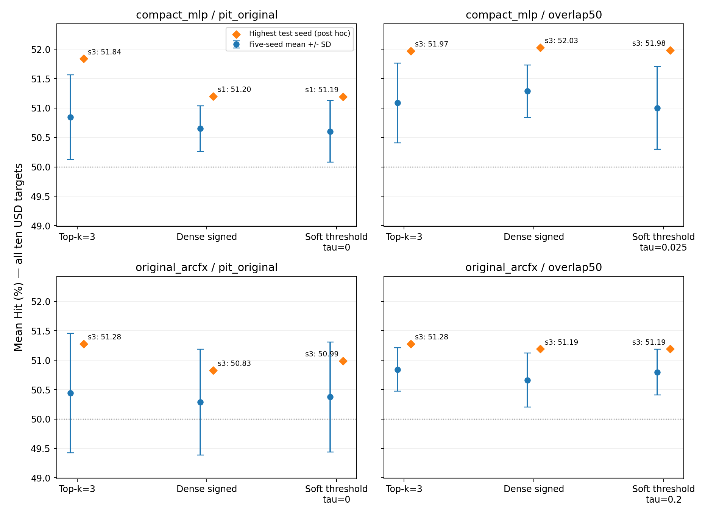

# Graph 선택 연산 비교 요약

두 본체 × 세 선택 연산 × 두 validation protocol을 비교했다. Tau와 epoch는 validation으로 선택했다. 요청한 최고 성능은 선택된 설정에서 test Hit가 가장 높은 seed이며 사후 최고값으로 표시한다. 전체 10개 USD 대비 대상과 공통 test 1,049일을 사용한다.

## 공통 test에서 모델별 최고값과 평균

아래 best_hit_pct는 %, seed_sd_pp는 %p다.

| backbone       | protocol     | selector       |     tau |   best_hit_pct |   best_test_seed |   best_epoch |   mean_hit_pct |   seed_sd_pp |
|:---------------|:-------------|:---------------|--------:|---------------:|-----------------:|-------------:|---------------:|-------------:|
| compact_mlp    | overlap50    | dense_signed   | nan     |         52.031 |                3 |            5 |         51.287 |        0.447 |
| compact_mlp    | overlap50    | soft_threshold |   0.025 |         51.983 |                3 |            4 |         51.003 |        0.701 |
| compact_mlp    | overlap50    | topk           | nan     |         51.973 |                3 |            5 |         51.087 |        0.679 |
| compact_mlp    | pit_original | dense_signed   | nan     |         51.201 |                1 |            1 |         50.650 |        0.390 |
| compact_mlp    | pit_original | soft_threshold |   0.000 |         51.192 |                1 |            1 |         50.604 |        0.525 |
| compact_mlp    | pit_original | topk           | nan     |         51.840 |                3 |            4 |         50.845 |        0.718 |
| original_arcfx | overlap50    | dense_signed   | nan     |         51.192 |                3 |            3 |         50.663 |        0.458 |
| original_arcfx | overlap50    | soft_threshold |   0.200 |         51.192 |                3 |            3 |         50.797 |        0.390 |
| original_arcfx | overlap50    | topk           | nan     |         51.277 |                3 |            3 |         50.843 |        0.370 |
| original_arcfx | pit_original | dense_signed   | nan     |         50.829 |                3 |            2 |         50.288 |        0.903 |
| original_arcfx | pit_original | soft_threshold |   0.000 |         50.991 |                3 |            3 |         50.376 |        0.937 |
| original_arcfx | pit_original | topk           | nan     |         51.277 |                3 |            3 |         50.444 |        1.016 |

원래 분할에서는 두 본체 모두 Top-k의 최고값과 5-seed 평균이 가장 높았다. 겹침 분할의 MLP에서는 dense signed가 최고값/평균 모두 가장 높았고, 원래 ARC_FX에서는 Top-k가 가장 높았다. 이번 범위에서 validation-selected soft-threshold가 Top-k를 개선한다는 우위는 확인되지 않았다.

Seed도 test를 보지 않고 validation으로 고른 경우의 test 결과:

| backbone       | protocol     | selector       |     tau |   validation_selected_seed |   test_hit_validation_selected_seed_pct |
|:---------------|:-------------|:---------------|--------:|---------------------------:|----------------------------------------:|
| compact_mlp    | overlap50    | dense_signed   | nan     |                          3 |                                  52.031 |
| compact_mlp    | overlap50    | soft_threshold |   0.025 |                          3 |                                  51.983 |
| compact_mlp    | overlap50    | topk           | nan     |                          3 |                                  51.973 |
| compact_mlp    | pit_original | dense_signed   | nan     |                          4 |                                  50.601 |
| compact_mlp    | pit_original | soft_threshold |   0.000 |                          1 |                                  51.192 |
| compact_mlp    | pit_original | topk           | nan     |                          1 |                                  51.249 |
| original_arcfx | overlap50    | dense_signed   | nan     |                          3 |                                  51.192 |
| original_arcfx | overlap50    | soft_threshold |   0.200 |                          3 |                                  51.192 |
| original_arcfx | overlap50    | topk           | nan     |                          3 |                                  51.277 |
| original_arcfx | pit_original | dense_signed   | nan     |                          3 |                                  50.829 |
| original_arcfx | pit_original | soft_threshold |   0.000 |                          3 |                                  50.991 |
| original_arcfx | pit_original | topk           | nan     |                          3 |                                  51.277 |

## Validation과 test의 겹침 효과

Same-seed 평균 차이이며 overlap-selected − original-validation-selected 방향이다. 두 protocol의 test 날짜는 동일하다.

| backbone       | selector       |   difference_pp |   ci_low_pp |   ci_high_pp |
|:---------------|:---------------|----------------:|------------:|-------------:|
| compact_mlp    | topk           |           0.242 |      -0.267 |        0.744 |
| compact_mlp    | dense_signed   |           0.637 |       0.200 |        1.079 |
| compact_mlp    | soft_threshold |           0.398 |      -0.008 |        0.810 |
| original_arcfx | topk           |           0.398 |       0.082 |        0.694 |
| original_arcfx | dense_signed   |           0.376 |      -0.025 |        0.766 |
| original_arcfx | soft_threshold |           0.421 |       0.095 |        0.751 |

## 선택된 모델의 실제 graph 활성 정도

| backbone       | protocol     |   tau |   mean_neighbors |   zero_neighbor_fraction |   active_edge_fraction |   message_rms |
|:---------------|:-------------|------:|-----------------:|-------------------------:|-----------------------:|--------------:|
| compact_mlp    | overlap50    | 0.025 |            9.564 |                    0.000 |                  0.956 |         0.486 |
| compact_mlp    | pit_original | 0.000 |           10.000 |                    0.000 |                  1.000 |         0.469 |
| original_arcfx | overlap50    | 0.200 |            5.842 |                    0.083 |                  0.584 |         0.391 |
| original_arcfx | pit_original | 0.000 |           10.000 |                    0.000 |                  1.000 |         0.478 |

compact_mlp/pit_original은 validation에서 tau=0을 선택했다. 이 경우 임계값에 의한 희소화는 없으며 row-mass cap을 가진 signed score 변환이다.

original_arcfx/pit_original은 validation에서 tau=0을 선택했다. 이 경우 임계값에 의한 희소화는 없으며 row-mass cap을 가진 signed score 변환이다.

## 기간과 해석

- Train: 2005-01-18–2017-07-24 (decision date).
- 원래 validation: 2017-07-25–2021-10-05, 1,048일.
- 겹침 validation: 2019-08-30–2023-11-09, 1,048일.
- 공통 test: 2021-10-06–2025-12-17, 1,049일. 수익률 종료일은 2021-10-07–2025-12-18.
- 겹침: 524일, validation 50% / test 49.95%. 뒤쪽 비중복 test는 525일이다.
- 겹친 test label은 optimizer의 fitting label에 포함되지 않지만 checkpoint/tau 선택에 사용된다. 따라서 겹침 점수는 독립적인 test 성능이 아니다.
- 최고 seed를 고른 효과도 반영되지 않으므로 최고값과 5-seed 평균을 함께 보고한다. 날짜 블록 bootstrap은 선택 편향을 교정하지 않는다.
- 두 본체의 구조/손실은 각각 유지했으나 이번 training budget은 공통 max20/patience4/batch256, constant LR다. 기존 PIT의 80-epoch 학습 전체를 재현한 것이 아니라 원래 기간 설정을 사용한 통제 비교다.
- 입력 window는 양쪽 본체 모두 t까지 10개 row로 고정했다. 이는 원래 sequence 구현의 t−1 추가 지연과 다르다. 당일 spot 가용성에 관한 시장 피드 가정은 남아 있다.

상세한 validation tau grid, 부분기간 성능, 모델 간 paired CI와 재현 설명은 REPORT_KO.md에 있다.



```powershell
python src/arcfx_selector_compare.py
python src/check_arcfx_selector_compare.py
python src/arcfx_selector_supplement.py
```
